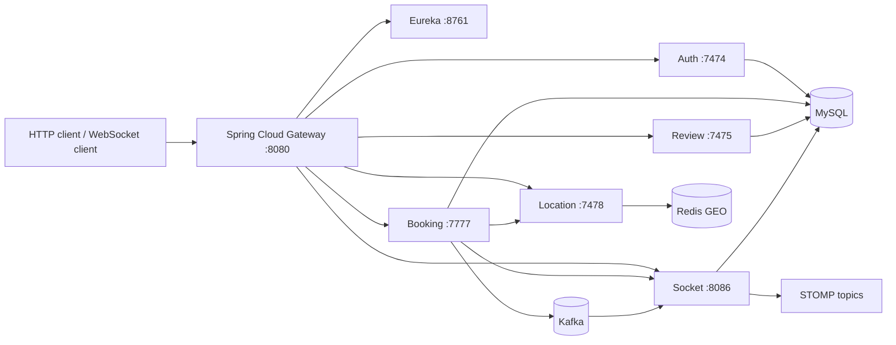

# Uber-Style Ride-Hailing Backend

A Java/Spring Boot microservices project that models core ride-hailing workflows: passenger/driver authentication, booking state changes, nearby-driver lookup, review management, and real-time ride notifications.

The repository contains seven runnable applications plus a shared entity/model library. It is a learning and portfolio project; the README describes the source currently present and does not claim production-grade reliability or security.

## Architecture



### Applications and ports

| Module | Default port | Responsibility |
|---|---:|---|
| `UberServiceDiscovery` | 8761 | Eureka server; service registration/discovery |
| `UberApiGateway` | 8080 | Routes HTTP requests to backend services and exposes actuator endpoints configured in the gateway |
| `UberProject-AuthService` | 7474 | Passenger/driver signup and sign-in; JWT is issued in an HTTP cookie |
| `UberBookingService` | 7777 | Creates bookings, validates booking status transitions, attempts driver reservation, and emits booking events |
| `UberProject-LocationService` | 7478 | Stores driver coordinates in Redis GEO and queries nearby drivers |
| `UberReviewService` | 7475 | Creates, lists, retrieves, updates, and deletes reviews |
| `ClientSocketService` | 8086 | WebSocket/STOMP messaging and Kafka-event forwarding to client topics |
| `Uber-entityService` | Library | Shared JPA entities and domain enums used by the services |

Java modules use the Java 21 toolchain, Spring Boot 3.4.3, and Spring Cloud 2024.0.0 in the inspected Gradle build files.

## Main request flows

### Create a booking

1. A client sends a booking request through the gateway to the booking service.
2. `BookingController` accepts `POST /api/v1/booking` and optionally reads the `Idempotency-Key` header.
3. `BookingServiceImpl` creates a booking with initial status `REQUESTED` and saves it through `BookingRepository`.
4. When a transaction is active, it registers Kafka publication for after the database transaction commits.
5. It asynchronously asks the location service for nearby drivers and then attempts to notify drivers through the socket service.

**Reliability note:** after-commit publication is not a transactional outbox. If the process stops after the database commit but before Kafka accepts the event, the booking can persist without the event being published. The producer logs asynchronous send failures but does not implement a durable retry/outbox flow in the inspected code.

### Driver location lookup

The location controller exposes endpoints under `/api/location`. Driver coordinates are stored and queried using Redis GEO operations. The location service is called by the booking service when looking for nearby drivers.

### Real-time notifications

The socket service accepts ride requests and uses STOMP destinations including `/topic/rideRequest`, `/topic/rideResponse`, and `/topic/passengerNotification`. Its Kafka listener forwards consumed event payloads to shared topics. These are broadcast topics in the current code; do not assume per-user delivery or authorization from the topic names alone.

## HTTP endpoint reference

These paths are defined by the inspected controllers. The gateway has route predicates for some alternate paths, but the backend controller mapping remains authoritative.

### Authentication — `/api/v1/auth`

| Method | Path | Purpose |
|---|---|---|
| `POST` | `/signup/passenger` | Register a passenger |
| `POST` | `/signup/driver` | Register a driver |
| `POST` | `/signin/passenger` | Sign in a passenger |
| `POST` | `/signin/driver` | Sign in a driver |

Successful sign-in sets a cookie named `jwt`. Review cookie flags and authentication/authorization coverage before exposing the service publicly.

### Booking — `/api/v1/booking`

| Method | Path | Purpose |
|---|---|---|
| `POST` | `/` | Create a booking; optional `Idempotency-Key` header |
| `PATCH` or `POST` | `/{bookingId}` | Update booking status and optionally associate a driver |

The create request uses `CreateBookingDto`; the update request uses `UpdateBookingRequestDto`. Valid status transitions are checked through the shared `BookingStatus` domain model.

### Driver location — `/api/location`

| Method | Path | Purpose |
|---|---|---|
| `POST` | `/setDriverLocation` or `/drivers` | Save driver coordinates |
| `POST` | `/nearby/drivers` | Find nearby drivers from latitude/longitude |
| `GET` | `/driver/{driverId}` | Fetch a driver's stored location |

### Reviews — `/api/v1/reviews`

| Method | Path | Purpose |
|---|---|---|
| `POST` | `/` | Create a review |
| `GET` | `/` | List reviews |
| `GET` | `/{reviewId}` | Fetch one review |
| `PUT` | `/{reviewId}` | Update a review |
| `DELETE` | `/{reviewId}` | Delete a review |

### Socket service

- HTTP ride-request endpoint: `POST /api/socket/newride`
- STOMP application destination: `/app/rideResponse/{userId}`
- Topics used in the current implementation include `/topic/rideRequest`, `/topic/rideResponse`, and `/topic/passengerNotification`.

The WebSocket endpoint path is configured in the socket service's WebSocket configuration. Connect to that configured endpoint before subscribing or sending STOMP messages.

## Technology stack

- **Language/runtime:** Java 21
- **Application framework:** Spring Boot 3.4.3
- **Service discovery/routing:** Netflix Eureka, Spring Cloud Gateway, Spring Cloud LoadBalancer
- **Persistence:** Spring Data JPA, MySQL, Flyway in the shared entity module
- **Location indexing:** Redis GEO, Spring Data Redis/Jedis
- **Messaging:** Apache Kafka, Spring Kafka
- **Real-time messaging:** Spring WebSocket, STOMP
- **HTTP service clients:** Retrofit and Spring `RestTemplate` in the relevant service code
- **Local infrastructure:** Docker Compose

## Local development

### Prerequisites

- JDK 21
- Docker Engine and Docker Compose
- Network access to download Gradle/Maven dependencies

### Configure environment

Copy the example environment file:

```bash
cp .env.example .env
```

Review every value before running. The Compose file directly consumes `DB_PASSWORD` and `JWT_SECRET`; individual Spring services also use variables such as `DB_URL`, `DB_USERNAME`, `KAFKA_BOOTSTRAP_SERVERS`, `EUREKA_SERVER_URL`, `REDIS_HOST`, and `REDIS_PORT`. Compose supplies service-specific URLs for container-to-container communication.

**Local-only defaults:** the Compose file has development fallback credentials. Replace them for any shared or deployed environment. Do not commit real secrets.

### Build the shared entity library and service JARs

The Dockerfiles copy prebuilt JARs from each module's `build/libs/` directory. They do not compile the Java source inside the Docker image, so build the artifacts before asking Compose to build the images.

From the repository root, publish the shared entity library to Maven Local first:

```bash
./gradlew -p Uber-entityService clean publishToMavenLocal
```

Then build the runnable modules:

```bash
./gradlew -p UberServiceDiscovery clean bootJar
./gradlew -p UberApiGateway clean bootJar
./gradlew -p UberProject-AuthService clean bootJar
./gradlew -p UberBookingService clean bootJar
./gradlew -p UberProject-LocationService clean bootJar
./gradlew -p UberReviewService clean bootJar
./gradlew -p ClientSocketService clean bootJar
```

If a dependency cannot be resolved, check the shared library publication and each module's Gradle configuration before proceeding.

### Start infrastructure and services

After the JARs exist:

```bash
docker compose up --build -d
docker compose ps
docker compose logs -f
```

Published host ports from the Compose file:

| Component | Local address |
|---|---|
| Gateway | `http://localhost:8080` |
| Eureka dashboard | `http://localhost:8761` |
| MySQL | `localhost:3307` (container port 3306) |
| Redis | `localhost:6379` |
| Kafka host listener | `localhost:9092` |

Inside Compose, services use Docker DNS names such as `mysql:3306`, `redis:6379`, and `kafka:29092`. Wait for dependencies and service registration to complete before testing API calls.

Stop the stack with:

```bash
docker compose down
```

To remove the persisted MySQL volume as well, use `docker compose down -v`; this deletes local database data.

## Tests

The repository contains JUnit tests for selected behavior, including booking status transitions, idempotency service behavior, booking API integration, concurrent driver reservation, gateway correlation IDs, and review operations.

Run an individual module's tests from the repository root, for example:

```bash
./gradlew -p UberBookingService test
./gradlew -p UberApiGateway test
```

Run the booking concurrency test by its class name:

```bash
./gradlew -p UberBookingService test --tests com.example.uberbookingservice.BookingConcurrencyTest
```

These commands document how to invoke the test tasks; they are not a claim that every test currently passes in every environment.

## Known implementation boundaries

- **Kafka/database consistency:** booking events are sent after commit, not through a transactional outbox.
- **Idempotency scope:** booking idempotency uses Redis with a 10-minute TTL when available and an in-memory fallback. The fallback is process-local, and the read-then-create flow is not an atomic distributed reservation for a key.
- **Kafka delivery:** producer send failures are logged; the inspected producer does not provide a durable retry/DLT workflow.
- **WebSocket fan-out:** the Kafka consumer forwards messages to shared STOMP topics. Treat these as broadcasts unless authorization and user-specific routing are added and verified.
- **Container build:** Docker images require the module JARs to be built beforehand.
- **Development configuration:** replace fallback credentials and review permissive CORS settings before deployment.

## Repository layout

```text
UberProject/
├── UberApiGateway/
├── UberServiceDiscovery/
├── UberProject-AuthService/
├── UberBookingService/
├── UberProject-LocationService/
├── UberReviewService/
├── ClientSocketService/
├── Uber-entityService/
├── docker-compose.yml
├── .env.example
└── gradlew
```

## Further documentation

- [API documentation and testing notes](API_DOCUMENTATION_AND_TESTING.md)
- [Architecture decision records](docs/adr/)
- [Project review notes](project_review.md)

## License

Check the repository's license file for the applicable reuse and distribution terms.
